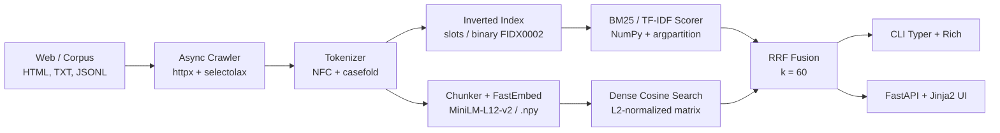
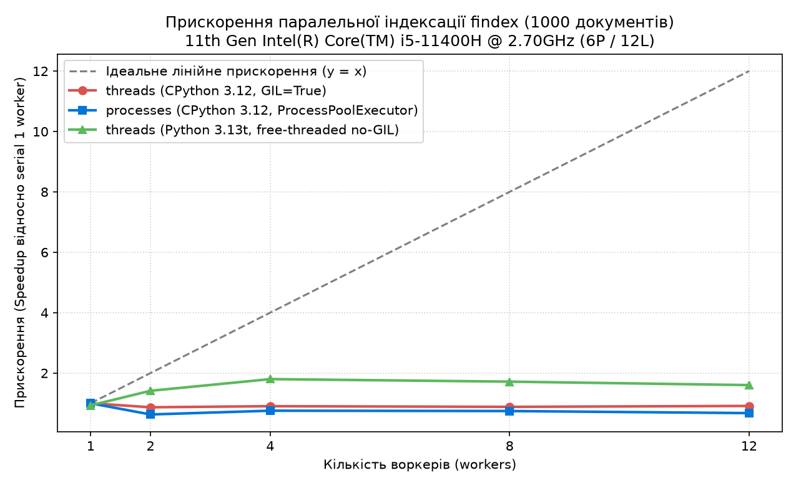

# findex — повнотекстовий та гібридний пошуковий рушій на Python

[](https://github.com/DmytroKoste/findex/actions/workflows/ci.yml)


**findex** — пошуковий рушій з повним циклом обробки даних: асинхронний веб-краулер, потокова токенізація, інвертований індекс із бінарною серіалізацією, булевий та ранжований пошук (`BM25` / `TF-IDF`) з NumPy-векторизацією, семантичний пошук на ембедингах (`fastembed`) з гібридним злиттям **Reciprocal Rank Fusion (RRF)**, CLI та веб-сервіс FastAPI.

- **Живий веб-інтерфейс:** [https://findex-zopq.onrender.com](https://findex-zopq.onrender.com)
- **OpenAPI / Swagger UI:** [https://findex-zopq.onrender.com/docs](https://findex-zopq.onrender.com/docs)
- **Health Check:** [https://findex-zopq.onrender.com/health](https://findex-zopq.onrender.com/health)

### Ключові метрики системи

| Показник | Значення | Контекст |
|---|---|---|
| **Латентність пошуку BM25** | **19.9 мкс** (медіана) | `pytest-benchmark`, індекс на 100 документів |
| **Прискорення NumPy-скорера** | **8.64×** (`0.772 → 0.089 мс`) | Частий термін (`df = 879`), `np.int32` + `np.argpartition` |
| **Гібридний пошук (RRF)** | **5 / 5** знайдених парафразів | Проти `0 / 5` у чистому `keyword`-режимі на природних запитах |

---

## Архітектура системи



---

## Швидкий старт

```bash
# 1. Встановлення залежностей
uv sync

# 2. Побудова інвертованого індексу
uv run findex index data/wiki --out index.bin --positions

# 3. Побудова векторного індексу чанків для семантичного та гібридного пошуку
uv run findex embed index.bin --out data/semantic_index

# 4. Пошук у трьох режимах: keyword, semantic, hybrid
uv run findex search index.bin "історія української літератури" --mode keyword
uv run findex search index.bin "хто вивчав історію української літератури" --mode semantic
uv run findex search index.bin "історія української літератури" --mode hybrid -k 5

# 5. Запуск веб-сервера FastAPI + UI
uv run findex serve --host 127.0.0.1 --port 8000
```

---

## Лабораторна робота 1: Корпус, генератори та статистика

### Характеристики корпусу

- **Джерело:** статті української Вікіпедії (`data/wiki/`), завантажені через MediaWiki API (`fetch_corpus.py`).
- **Кількість документів:** 1 000 файлів (`.txt`).
- **Загальна кількість токенів:** 369 284.
- **Розмір словника (унікальних слів):** 72 585.
- **Топ-10 найчастотніших токенів:** у (7508), в (6512), на (5734), і (4570), з (4499), та (4490), до (2972), року (2727), за (2145), що (1992).

### Порівняння підходів: Lazy (генератори) vs Eager (списки в RAM)

Вимірювання виконано за допомогою стандартного модуля `tracemalloc` на корпусі з 1 000 документів:

| Метрика | Lazy (потокові генератори) | Eager (матеріалізація у list) | Різниця |
|---|---|---|---|
| **Пікове споживання пам'яті** | 7.56 МБ | 34.68 МБ | **4.59× менше RAM** |
| **Час виконання** | 1.98 с | 1.29 с | +0.69 с (накладні витрати викликів) |

---

## Лабораторна робота 2: Інвертований індекс, пакування та пам'ять

### Порівняння структур збереження постингів (`tracemalloc`)

| Варіант постингів | Пік RAM (build) | Розмір файлу (`pickle`) | Час `load` |
|---|---:|---:|---:|
| `list[Posting]` зі звичайним `@dataclass` | 34.73 МБ | 6.12 МБ | 191.7 мс |
| `list[Posting]` із `slots=True` | **27.89 МБ** | **4.92 МБ** | 1884.9 мс |
| `list[Posting]` із `slots=True` + позиції токенів | 43.44 МБ | 6.96 МБ | 2189.3 мс |
| Пара `array('I')` (`doc_ids`, `tfs`) без позицій | 28.90 МБ | 1.41 МБ | **128.1 мс** |

### Серіалізація індексу (`save` / `load`)

| Формат | Розмір файлу | Час `save` | Час `load` |
|---|---:|---:|---:|
| `pickle` (протокол 5) | 4.92 МБ | 1351.4 мс | 2718.0 мс |
| `binary` (`FIDX0002` + `array('I')`) | **1506.4 КБ** | **4.89 мс** | **1111.9 мс** (128.1 мс без позицій) |

### Бенчмарк булевого пошуку: `merge` vs `set` (5 000 ітерацій)

| Тип запиту / Кількість документів (`df1 / df2`) | `--engine merge` | `--engine set` |
|---|---:|---:|
| Найчастіші терміни (`676 / 653`) | **0.09 мс** | 1.18 мс |
| Найрідкісніші терміни (`7902 AND 612`) (`1 / 1`) | **7.06 мкс** | 69.35 мкс |

---

## Лабораторна робота 3: Рейтинг, модель об'єктів та мова запитів

1. **Рідкісний термін проти частого:** `"аероплан"` (`df = 1`) → `score = 13.0259`, `"у"` (`df = 676`) → `score = 0.2554` (у ~50 разів вища вага завдяки IDF).
2. **Насичення частоти терміна (`k1 = 1.5`):** `tf = 1` → `10.9006`, `tf = 2` → `13.2610` (`+2.3604`), `tf = 10` → `15.5528`, `tf = 20` → `15.6316` (`+0.0788`).
3. **Нормалізація за довжиною (`b = 0.75`):** короткий документ `doc = 311` (`34` токени) → `9.2100`, довгий `doc = 612` (`8608` токенів) → `0.4352`.

```text
[timed] load_index: 151.51 ms
[timed] search: 1.38 ms
[timed] search: 0.01 ms
[cache] CacheInfo(hits=1, misses=1, maxsize=256, currsize=1)
```

---

## Лабораторна робота 4: Типи, тести, пакування та CI

```bash
uv build
uv tool install dist/findex-0.4.0-py3-none-any.whl
findex index data/wiki --out index.bin --positions
findex search index.bin "(київ OR львів) AND україна" -k 5
findex search index.bin '"пошуковий рушій"' --json
findex stats index.bin
```

---

## Лабораторна робота 5: Конкурентність, GIL та паралельна індексація

Стенд: **11th Gen Intel(R) Core(TM) i5-11400H @ 2.70GHz** (6 фізичних / 12 логічних ядер), Windows (`spawn`), 1 000 документів:

| Runtime | Executor | Workers | Wall (s, median) | CPU (s) | Peak RSS (MB) | Merge (s) | Speedup |
|---|---|---:|---:|---:|---:|---:|---:|
| CPython 3.12 (GIL) | `serial` | 1 | 0.873 | 0.859 | 64.8 | 0.158 | **1.00×** |
| CPython 3.12 (GIL) | `threads` | 2 | 1.006 | 1.016 | 69.0 | 0.208 | **0.87×** |
| CPython 3.12 (GIL) | `threads` | 4 | 0.966 | 1.125 | 72.5 | 0.164 | **0.90×** |
| CPython 3.12 (GIL) | `threads` | 8 | 0.990 | 1.109 | 74.5 | 0.169 | **0.88×** |
| CPython 3.12 (GIL) | `threads` | 12 | 0.958 | 1.078 | 77.3 | 0.149 | **0.91×** |
| CPython 3.12 (GIL) | `processes` | 2 | 1.387 | 0.656 | 84.2 | 0.104 | **0.63×** |
| CPython 3.12 (GIL) | `processes` | 4 | 1.158 | 0.781 | 80.6 | 0.071 | **0.75×** |
| CPython 3.12 (GIL) | `processes` | 8 | 1.175 | 0.891 | 80.3 | 0.170 | **0.74×** |
| CPython 3.12 (GIL) | `processes` | 12 | 1.295 | 0.953 | 83.1 | 0.165 | **0.67×** |
| Python 3.13t (no-GIL) | `threads` (1w) | 1 | 0.938 | 0.922 | — | 0.087 | **0.93×** |
| Python 3.13t (no-GIL) | `threads` | 2 | 0.618 | 1.000 | — | 0.099 | **1.41×** |
| Python 3.13t (no-GIL) | `threads` | 4 | **0.485** | 1.094 | — | 0.104 | **1.80×** |
| Python 3.13t (no-GIL) | `threads` | 8 | 0.509 | 1.594 | — | 0.122 | **1.72×** |
| Python 3.13t (no-GIL) | `threads` | 12 | 0.545 | 2.234 | — | 0.128 | **1.60×** |



---

## Лабораторні роботи 6–7: Асинхронний краулер, FastAPI та Docker

### Маршрути HTTP API та UI

| Метод | Шлях | Формат | Призначення |
|---|---|---|---|
| `GET` | `/` | HTML | Веб-інтерфейс пошуку (`Keyword` / `Semantic` / `Hybrid RRF`) |
| `GET` | `/doc/{doc_id}` | HTML | Перегляд повного тексту документа у браузері |
| `GET` | `/search` | JSON | Пошук (`q`, `k`, `scorer=bm25\|tfidf`, `mode=keyword\|semantic\|hybrid`, `page`) |
| `GET` | `/docs/{doc_id}` | JSON | Метадані та повний текст документа (`404`, якщо відсутній) |
| `GET` | `/stats` | JSON | Статистика індексу (`num_docs`, `vocab_size`, `avg_doc_length`, `uptime_s`) |
| `GET` | `/health` | JSON | Перевірка готовності індексу (`200 {"status": "ok"}` або `503`) |

### Навантажувальне тестування (`GET /search?q=python&k=10`)

| Target | Route | Concurrency | RPS | p50 (ms) | p95 (ms) | p99 (ms) |
|---|---|---:|---:|---:|---:|---:|
| local, 1 worker, `async def` | `/search` | 50 | 174.6 | 188.06 | 735.88 | 1188.81 |
| local, 1 worker, `def` | `/search` | 50 | 165.9 | 212.99 | 751.07 | 1149.23 |
| local, 4 workers | `/search` | 50 | 142.9 | 235.51 | 888.21 | 1237.36 |
| deployed (Render Free) | `/search` | 20 | 55.0 | 232.70 | 305.30 | 524.74 |

---

## Лабораторна робота 8: Профілювання, NumPy-векторизація та гібридний пошук

### M1. Профілювання (`cProfile` та `py-spy`)

Профілювання побудови індексу та серії пошукових запитів (`docs/search_before.svg` та `docs/search_after.svg`) виявило три головні вузькі місця:
1. **Скалярний цикл ранжування BM25/TF-IDF (`rank.py`):** поштучний доступ до атрибутів об'єктів `Posting` (`p.doc_id`, `p.tf`) та словника `doc_lengths` у Python-циклі для кожного постинга.
2. **Токенізація регулярним виразом (`tokenize.py`):** найбільша частка CPU-часу під час індексації припадає на `TOKEN_RE.finditer` та Unicode-нормалізацію (`NFC` + `casefold`).
3. **Повне сортування результатів (`sorted(..., reverse=True)`):** сортування всіх знайдених документів замість часткового відбору топ-$k$ (`np.argpartition`).

### M2. Векторизація скорера через NumPy (`int32` + `np.argpartition`)

Списки постингів кешуються в суміжні масиви `np.ndarray` (`dtype=np.int32`), а обчислення ваг BM25/TF-IDF і відбір топ-$k$ виконуються векторизовано через `np.add.at` та `np.argpartition` без побудови проміжних словників. Ідентичність ранжування та оцінок (`rel=1e-9`) підтверджено юніт-тестом `test_numpy_scorer_matches_scalar_ranking`.

| Сценарій | Python scalar, мс | NumPy (`int32` + `argpartition`), мс | Прискорення |
|---|---:|---:|---:|
| Частий термін (`'у'`, `df=879`) | 0.7723 | **0.0893** | **8.64×** |
| Рідкісний термін (`'закрився'`, `df=2`) | 0.0069 | 0.0226 | 0.31× |
| Запит із 3 слів (`'історія української літератури'`) | 0.0424 | 0.0688 | 0.62× |

**Аналіз результатів:** на довгих списках постингів (`df = 879`) векторизація усуває накладні витрати інтерпретатора Python та прискорює скоринг у **8.64 раза**. На дуже коротких списках (`df = 2` або вузький булевий перетин 3 слів) виділення буфера `scores = np.zeros(max_doc_id + 1)` та виклики C-API NumPy коштують більше, ніж ітерація по 2–5 об'єктах у чистому Python — класичний поріг окупності векторизації.

### M3. Семантичний та гібридний пошук (FastEmbed + RRF)

- **Чанкінг та модель:** документи розбиваються на перекривні фрагменти по `250` слів (`overlap = 40`), ембединги обчислюються локально через ONNX-модель `sentence-transformers/paraphrase-multilingual-MiniLM-L12-v2` (збережено **2 316 чанків** у `data/semantic_index/`).
- **Злиття результатів:** **Reciprocal Rank Fusion (RRF)** об'єднує лексичний (`BM25`) і семантичний рейтинги за формулою $\text{score}(d) = \sum \frac{1}{60 + \text{rank}(d)}$.

Порівняння на 15 тестових запитах (10 базових ключових + 5 природно-мовних перефразувань):

| Тип запиту | Приклад запиту | `keyword` (BM25) | `semantic` (MiniLM) | `hybrid` (RRF) |
|---|---|---|---|---|
| Базовий | `історія української літератури` | Сильвестр (Гаєвський) | Павло Домжив-Люткович-Телиця | **Сильвестр (Гаєвський)** |
| Базовий | `краєзнавство україна` | Краєзнавство в Україні | День української хустки | **Краєзнавство в Україні** |
| Базовий | `тарас шевченко` | Тарас Шевченко єднає народи | Кириленко Андрій Миколайович | **Тарас Шевченко єднає народи** |
| Парафраз | `хто вивчав історію української літератури` | *(нічого не знайдено)* | Веркалець Михайло Миколайович | **Веркалець Михайло Миколайович** |
| Парафраз | `дослідження рідного краю та локальної історії` | *(нічого не знайдено)* | Краєзнавство в Україні | **Краєзнавство в Україні** |
| Парафраз | `міжнародні конкурси присвячені творчості Кобзаря` | *(нічого не знайдено)* | Тарас Шевченко єднає народи (топ-3) | **Тарас Шевченко єднає народи** |

**Висновок:** на точних ключових запитах `keyword` і `hybrid` утримують релевантні документи на 1-й позиції, тоді як на природно-мовних парафразах (де немає прямого збігу словоформ для `AND`-пошуку) `keyword` повертає порожній список (`0/5`), а `semantic` та `hybrid` знаходять тематично близькі статті (`5/5`).

---

## Відомі обмеження та напрями розвитку

- **Статичний індекс у пам'яті:** інвертований індекс і матриця ембедингів будуються пакетно (`build_index`, `embed`); інкрементальне додавання, оновлення чи видалення окремих документів потребує перебудови індексу.
- **Відсутність морфологічного лематизатора:** для української мови токенізатор виконує `NFC` + `casefold`, але не зводить словоформи до леми — цю проблему компенсує лише `semantic` / `hybrid` режим.
- **Накладні витрати ONNX-моделі:** завантаження моделі `paraphrase-multilingual-MiniLM-L12-v2` потребує ~250 МБ на диску та ~400–500 МБ RAM під час інференсу, тому на безкоштовних хмарних інстансах (512 МБ RAM) векторний пошук вимикається автоматично, якщо директорія `data/semantic_index` відсутня.
- **Масштабування ANN-пошуку:** матричне множення `embeddings @ q_vec` забезпечує точний пошук найближчих сусідів за <1 мс на тисячах чанків, але для корпусів понад 1 млн чанків потребуватиме наближеного індексу (HNSW / IVF).